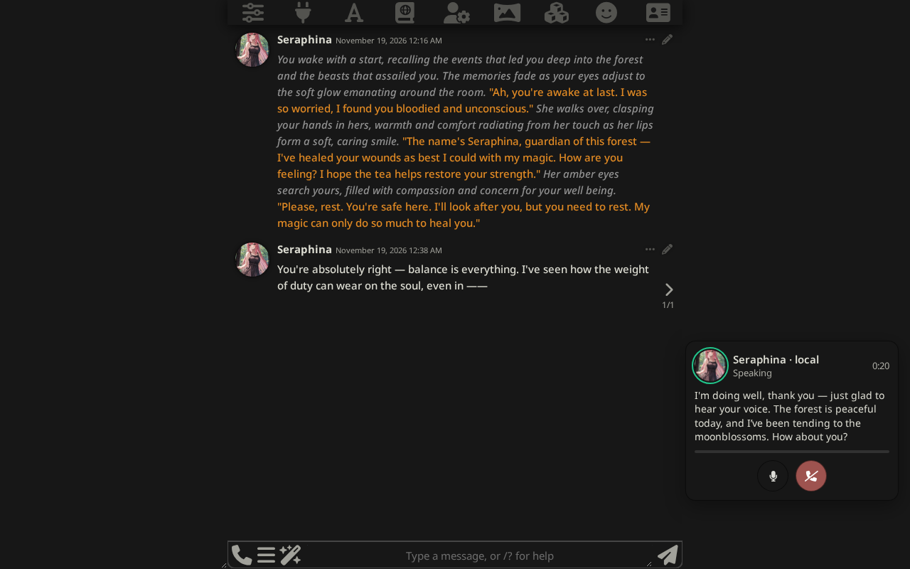

# Sophon Voice Call for SillyTavern

[中文](README_CN.md)

Talk to your character on a real-time, full-duplex voice call. Cut in whenever you like and they stop to listen; they can laugh and sigh; what they say goes into your chat.

Powered by the open-source [Sophon-Realtime](https://github.com/adventists-ai/sophon-realtime) (Apache-2.0): run it on your own GPU, or use the Adventists API.



## Features

- **Full duplex**: the model hears your voice directly (no speech-to-text in between), decides by itself when you have finished, and starts answering in well under a second. Talk over it at any time and it stops.
- **Stays in character**: the card (description, personality, scenario), your persona and the latest chat messages go into the call, so the character picks up where the text chat left off.
- **A voice per character**: 5 built-in voices, or a voice you cloned.
- **Back into the chat**: each line the character says is added to the conversation. If you cut in or hang up, only what you actually heard is kept.
- Your own GPU or the API; English / Chinese UI; `/sophon-call` slash command.

## Install

SillyTavern → **Extensions** → **Install extension** → paste:

```
https://github.com/adventists-ai/sophon-sillytavern
```

## Option 1: your own GPU (free, nothing leaves your machine)

Run any Sophon-Realtime server (Tag, Flash or E2E; 32B or 4B). For role-play on one 24 GB card (RTX 4090 / 3090 class) we suggest the 4-bit 4B Tag build, which keeps laughs, sighs and stress:

```bash
git clone https://github.com/adventists-ai/sophon-realtime && cd sophon-realtime/tag
SIZE=4B-W4 bash install.sh
GPU=0 PORT=8000 bash start.sh     # first start takes 15–20 min; serves http://127.0.0.1:8000
```

| Build | GPU |
|---|---|
| 4B Tag W4 / 4B Flash | one 24 GB GPU |
| 4B Tag | one 32 GB GPU |
| 32B Tag / Flash / E2E | one 80 GB GPU |

Details in the [deploy guide](https://github.com/adventists-ai/sophon-realtime). The 4B builds are good for companions and characters, but they know much less than 32B and can state wrong facts with confidence. The Mac (MLX) build uses a different protocol and is not supported yet.

In the extension settings choose **My own server**, enter the address and click **Test connection**.

## Option 2: Adventists API

No GPU? New accounts get **3 hours of free voice chat**. Sign up with your email in the console ([global](https://api.adventists.ai/console) · [mainland China](https://api.adventists.cn/console)) and create an API key. In the settings choose **Adventists API**, pick the endpoint, paste the key, choose a model and click **Test connection**:

- **Tag**: most expressive (laughs, sighs, stress).
- **Flash**: fastest.
- **E2E**: end-to-end speech, natural emotion.

All three are the 32B model. The key is stored in your own SillyTavern settings and sent from your browser straight to the Adventists endpoint (as a WebSocket subprotocol, because browsers cannot add headers to WebSockets), so use it only on a machine you trust. Trial accounts can make one call at a time, up to 10 minutes each.

## Give a character its own voice

- **Your own server**: put 3–10 s of clean speech from one speaker into the server's voices folder (5–12 s for E2E), e.g. `model/voices/alice.wav`, then type `alice` as the character's voice. Tag and Flash pick it up within seconds, no restart; the clip never leaves your machine.
- **API**: record or upload 3–15 s on the console's **Voices** page (Tag, Flash and E2E all take cloned voices), then paste the `voice_…` id.
- **Only clone your own voice, or a voice you have permission to use.**

## Use

Open a one-on-one chat and click the phone button next to the message box (or the extensions menu, or type `/sophon-call`). `/sophon-call end` hangs up.

- **Use headphones.** Without them the microphone hears the reply and the model may take it for you talking.
- The browser only allows the microphone on `https://` or `localhost`: open SillyTavern at `http://localhost:8000`, not over plain http from another device.

## Settings

- **Voice** (remembered per character): built-in `chelsie`, `vivian_zh`, `brand_zh`, `brand_en`, `ryan_en`, or a custom name / cloned id as above.
- **Language**: follows the interface by default; the model also answers in the language you speak.
- **Recent chat messages to include** (default 10). Actions and narration in `*asterisks*` are left out, so the character speaks instead of narrating.
- **Write the character's lines to the chat** (on by default).
- **Also write my side** (off by default): uses the browser's own speech recognition (Chrome / Edge), which runs on the browser vendor's service.

Group chats are not supported yet.

## License

Apache-2.0
