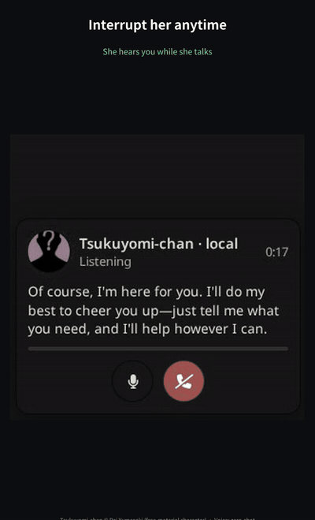
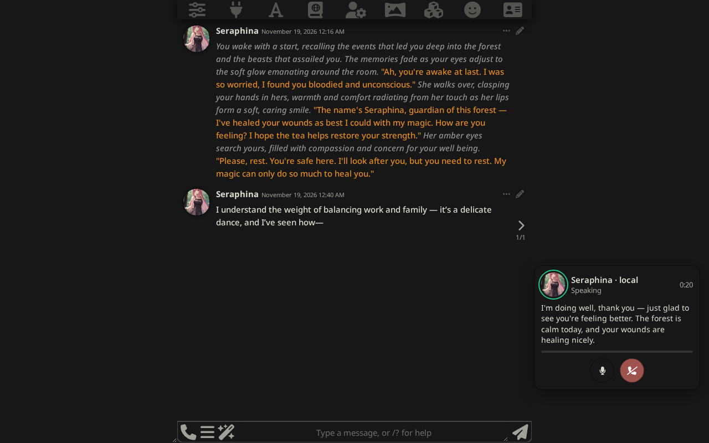

# Sophon 语音通话 · SillyTavern 插件

[English](README.md)

和角色卡打一通实时全双工语音电话：随时插话，角色马上停下来听；会笑、会叹气；说过的话写回聊天记录。

基于开源的 [Sophon-Realtime](https://github.com/adventists-ai/sophon-realtime)（Apache-2.0）：可以用自己的显卡部署，也可以用 Adventists API。

<p align="center"></p>

▶ **视频：** [2 分钟教程：安装、连接、克隆声音、通话](assets/demo_tutorial.mp4) · [45 秒短片](assets/demo_short.mp4) · [X 上的帖子](https://x.com/BKJinAI/status/2123275865257807933)

<sub>教程中的实测（32B Flash，浏览器与服务器在同一机房）：从你说完到听见她的声音约 0.7 秒；插话后她 0.16 秒停下。演示角色为免费素材角色「つくよみちゃん」（© Rei Yumesaki，https://tyc.rei-yumesaki.net/）；声音用「つくよみちゃんコーパス」（CV. 夢前黎）零样本克隆。非官方合作，仅作演示。</sub>



## 功能

- **全双工**：模型直接听你的声音（中间不经过语音转文字），自己判断你什么时候说完，不到一秒就开口；你随时插话，它就停。
- **不出戏**：角色卡（描述、性格、场景）、你的人设和最近的聊天都会带进通话，角色接着文字聊天往下说。
- **每个角色一个声音**：5 个内置音色，或你克隆的声音。
- **写回聊天**：角色说的每句话都写进对话；你插话或挂断时，只保留你实际听到的部分。
- 本地显卡或 API 二选一；中英文界面；`/sophon-call` 斜杠命令。

## 安装

SillyTavern → **扩展** → **安装扩展** → 粘贴：

```
https://github.com/adventists-ai/sophon-sillytavern
```

## 方式一：用自己的显卡（免费，数据不出本机）

部署任意 Sophon-Realtime 服务器（Tag、Flash 或 E2E，32B 或 4B）。一张 24 GB 显卡（RTX 4090 / 3090 级别）玩角色扮演，推荐 4B Tag 的 4-bit 版，笑声、叹气、重读都保留：

```bash
git clone https://github.com/adventists-ai/sophon-realtime && cd sophon-realtime/tag
SIZE=4B-W4 bash install.sh
GPU=0 PORT=8000 bash start.sh     # 第一次启动要 15–20 分钟；地址 http://127.0.0.1:8000
```

| 版本 | 显卡 |
|---|---|
| 4B Tag W4 / 4B Flash | 一张 24 GB |
| 4B Tag | 一张 32 GB |
| 32B Tag / Flash / E2E | 一张 80 GB |

详见[部署说明](https://github.com/adventists-ai/sophon-realtime)。4B 适合陪聊和角色扮演，但知道的比 32B 少很多，可能很肯定地说错事实。Mac（MLX）版接口协议不同，暂不支持。

在插件设置里选「我自己部署的服务器」，填地址，点「测试连接」。

## 方式二：Adventists API

没有显卡？注册送 **3 小时免费对话**。到控制台用邮箱注册并创建 API key（[国内](https://api.adventists.cn/console) · [海外](https://api.adventists.ai/console)）。设置里选「Adventists API」，选接入点，填 key，选版本，点「测试连接」：

- **Tag**：表现力最好（笑、叹气、重读）。
- **Flash**：最快。
- **E2E**：端到端语音，情绪自然。

三个都是 32B 模型。key 保存在你自己的酒馆设置里，由你的浏览器直接发给 Adventists 的接口（浏览器的 WebSocket 不能加请求头，所以放在子协议里），请只在自己信任的电脑上使用。试用账户同时只能打一通，每通最长 10 分钟。

## 给角色换成专属声音

- **自己部署**：把同一个人 3–10 秒的干净录音（E2E 要 5–12 秒）放进服务器的 voices 目录，例如 `model/voices/alice.wav`，角色音色填 `alice`。Tag 和 Flash 几秒内自动加载，不用重启；录音不出本机。
- **API**：在控制台「音色」页录音或上传 3–15 秒（Tag、Flash、E2E 都支持克隆音色），复制 `voice_…` id 填进来。
- **只克隆你本人或已获授权的声音。**

## 使用

打开和某个角色的单人聊天，点输入框旁的电话按钮（或扩展菜单，或输入 `/sophon-call`）。`/sophon-call end` 挂断。

- **请戴耳机。** 外放时麦克风会收到角色的声音，模型可能以为是你在说话。
- 浏览器只在 `https://` 或 `localhost` 下允许用麦克风：请用 `http://localhost:8000` 打开酒馆，不要从别的设备用普通 http 访问。

## 设置项

- **音色**（每个角色单独记住）：内置 `chelsie`、`vivian_zh`、`brand_zh`、`brand_en`、`ryan_en`，或上面说的自定义名 / 克隆 id。
- **语言**：默认跟随界面；模型也会跟着你说的语言回答。
- **带上最近几条聊天记录**（默认 10 条）。`*星号*` 里的动作和旁白会去掉，让角色开口说话而不是念旁白。
- **把角色说的话写进聊天记录**（默认打开）。
- **也把我说的话写进去**（默认关闭）：用浏览器自带的语音识别（Chrome / Edge），由浏览器厂商的服务完成。

暂不支持群聊。

## 许可证

Apache-2.0
